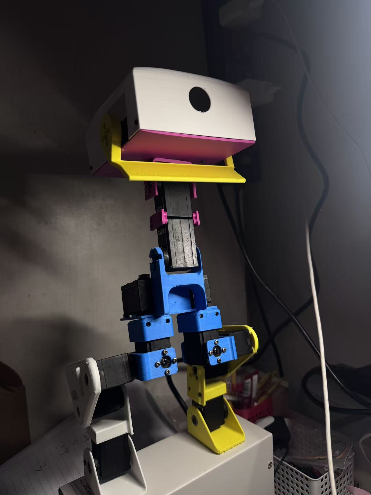
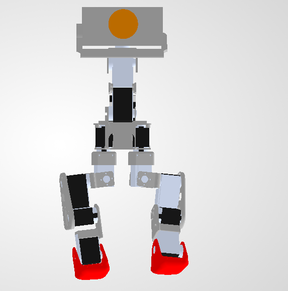
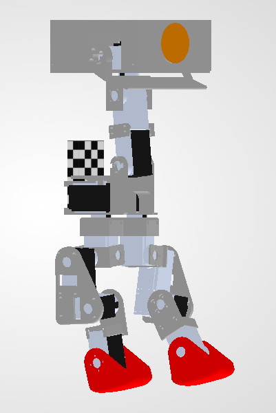

# microdick

microdick 是一个使用优必选舵机低成本复刻 Microduck 的双足机器人项目。参考项目为 Pollen Robotics 的 [Microduck](https://github.com/pollen-robotics/microduck)。

## 项目进度

- **机械设计**已有 SolidWorks 总装配和 3D 打印实物原型。
- **强化学习**处于第一阶段的仿真与训练开发中，已导出 ROS 2 和 ROS 1 的 URDF。
- **主控**已完成首版打样，目前正在测试。

## 后续更新

- **主控**会继续更新硬件设计和配套程序。
- **摄像头和麦克风**计划加入硬件接入方案和配套程序。
- **强化学习**计划发布训练好的模型权重、可直接运行的推理程序，以及运行所需的配置和启动说明。

## 装配图

  
  

## 模型文件

| 文件 | 用途 |
| --- | --- |
| [microdick.zip](microdick.zip) | SolidWorks 总装配和零件。完整解压后打开 `总装配.SLDASM`。 |
| [ROS 2 描述包](urdf/ROS2/microdick/) | 包含 `robot.urdf`、视觉与碰撞网格，以及 RViz 2 启动文件。 |
| [ROS 1 描述包](urdf/ROS1/microdick/) | 包含 ROS 1 版 URDF、网格和 RViz 启动文件。 |

两套 ROS 包的包名都是 `microdick`，各自在对应的 ROS 工作空间中使用。
